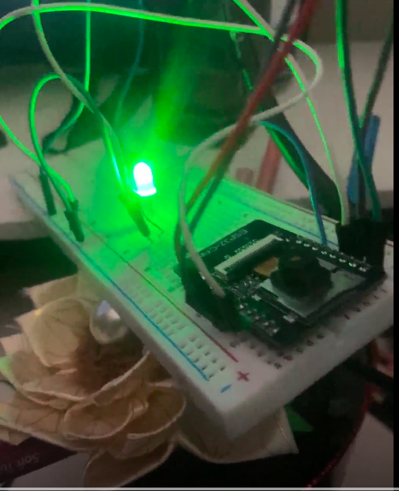

# ESP32-CAM Reed Switch Delayed Trigger



## Goal

Build a system where a magnetic reed switch (input) controls an LED (output) with a delay condition: the LED should only turn on after the reed switch has been continuously triggered (magnet away) for **10 seconds or more**. If the switch goes back to its resting state at any point, the LED should turn off immediately, and the 10-second timer should reset.

This was built on an **AI-Thinker ESP32-CAM**, alongside the existing camera streaming example code.

## Wiring

- **Reed switch** → GPIO14, using `INPUT_PULLUP`
- **LED** → GPIO13
## What Went Wrong (and how it got fixed)

This project ended up being a good lesson in isolating hardware issues from software issues — it took about 4 hours to fully debug.

### 1. Blocking delay from the camera example

The ESP32-CAM camera streaming example ships with `delay(10000)` inside `loop()`, since the actual camera server runs on a separate background task and `loop()` normally has nothing to do. Once sensor logic was added into that same `loop()`, this leftover delay silently broke everything — the reed switch was only being checked once every 10 seconds instead of continuously, which is far too infrequent for responsive timing logic.

**Fix:** Removed the long `delay()` and replaced it with a short debounce delay (tens of milliseconds).

### 2. Timer variable being reset every loop cycle

The timestamp used to track "how long has the switch been active" was being reset on every single loop iteration where the sensor was active, instead of only once at the moment it first became active. This meant the elapsed time could never accumulate past a few milliseconds, so the 10-second condition was never met.

**Fix:** Only set the timestamp once, guarded by a `timing` boolean that flips on the active-state transition, not on every loop pass.

### 3. Misattached `if / else`

An `else` block was pairing with the wrong `if` statement due to how the logic was nested, which meant the LED was being forced off almost every cycle regardless of the actual timer state.

**Fix:** Restructured the conditionals so the "turn off" logic is only reached when the sensor is actually inactive.

### 4. Reed switch polarity confusion

With `INPUT_PULLUP`, the logic is inverted from what's intuitive: magnet **away** reads HIGH, magnet **near** reads LOW. Needed to make sure the "trigger" condition in code matched the actual desired physical behavior (LED reacts to the magnet leaving, not approaching).

### 5. The real culprit: a dead GND pin

After all the software fixes were in place, the LED still didn't light up — not even in an isolated blink-only test sketch with no camera code at all. Systematic hardware isolation (testing GPIO13 completely on its own, checking LED polarity, checking the resistor, trying a different GPIO) eventually pointed to the actual problem: **one of the ESP32-CAM's GND pins simply wasn't working connection.**

Moving the ground wire to a different GND pin (and onto the breadboard's ground rail) immediately fixed it — the code had been correct for a while before this was caught.


## Lessons Learned

- When reusing example code, always scan for leftover `delay()` calls before adding your own time-sensitive logic into `loop()`.
- A timer/stopwatch variable should only be set **once**, at the moment of transition into the active state — not repeatedly while the condition remains true.
- Double-check `if/else` pairing carefully when nesting conditionals; indentation doesn't guarantee correct logical grouping.
- `INPUT_PULLUP` inverts expected logic — verify actual pin behavior with Serial output rather than assuming.
- When something "should obviously work" in code but doesn't, don't neglect hardware as a possible cause. Isolate with a minimal test sketch (like a plain blink) to rule out wiring/hardware before continuing to debug software.
- Not all GND pins on a board are guaranteed equal — a single bad ground connection can silently break an entire circuit while looking, on paper, completely correct.
- The ESP32-CAM overall was a frustrating board to work with — no onboard USB-serial chip (needs an external adapter), a fiddly GPIO0/reset flashing routine, and in this case a faulty GND pin. Would not buy this board again!

## Final Working Logic ( for the loop only) 

```cpp
void loop() {
  bool sensorActive = digitalRead(reedPin); // HIGH = magnet away (INPUT_PULLUP)

  if (sensorActive) {
    if (!timing) {
      timing = true;
      sensorHigh = millis();
    }
    if (!outputState && (millis() - sensorHigh >= delayTime)) {
      outputState = true;
      digitalWrite(ledPin, HIGH);
    }
  } else {
    timing = false;
    outputState = false;
    digitalWrite(ledPin, LOW);
  }

  delay(50);
}
```
